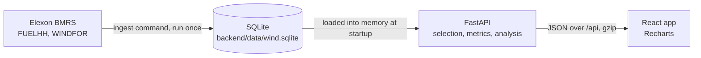

# UK wind forecast monitor

A web app for a day-ahead power trading desk. For every hour of January 2026 it shows the national
wind forecast a trader could actually have seen when the purchase decision was due, next to the wind
that was metered, and measures how far off those forecasts were.

- App: https://wind-monitor-three.vercel.app
- API docs (Swagger): https://wind-monitor-api.onrender.com/docs

Data comes from Elexon BMRS only: actual output from `FUELHH` (fuel type `WIND`, half-hourly) and
forecasts from `WINDFOR` (hourly points, eight runs a day).

## What the January data says

With the forecast available at the 09:20 day-ahead deadline, over all 768 hours of 1 Jan to 1 Feb:

| | MAE | Bias | RMSE | MAE as share of output |
|---|---|---|---|---|
| Day-ahead (09:20 UK on D-1) | 2,091 MW | +1,823 MW | 2,572 MW | 18.3% |
| Published at least 0 h before | 1,766 MW | +1,564 MW | 2,253 MW | 15.5% |
| 4 h before | 1,802 MW | +1,613 MW | 2,301 MW | 15.8% |
| 24 h before | 2,005 MW | +1,815 MW | 2,482 MW | 17.6% |
| 48 h before | 2,346 MW | +1,861 MW | 2,904 MW | 20.6% |

- The forecasts ran high: by 1.6 to 1.9 GW on average at every horizon, so most of the error is a
  steady over-forecast rather than random noise. The data alone does not say why.
- Day-ahead errors (forecast minus actual) had P10 / P50 / P90 of −406 / +1,638 / +4,251 MW. Actual
  output was at or above `forecast − 4,251 MW` in 90% of hours, which is the buffer a buyer can plan
  around. The app turns this into a "plan for at least X MW" figure for any forecast.
- Misses grow with the size of the forecast: MAE was about 1.2 GW when under 5 GW was forecast and
  about 4.5 GW when over 20 GW was forecast.
- The 48 h row covers 608 hours, not 768. Each forecast run ends at the end of the day after
  tomorrow, so the hours around midnight (22:00 to 02:00) have no run that old. The app flags the
  thinner sample.

## How a forecast is chosen

Every target hour is predicted by many runs. The app uses the newest run a trader could have seen,
under one of two rules:

- **Day-ahead** (the default view): for delivery day D, the latest run published by 09:20 UK time on
  D-1. 09:20 is gate closure for the EPEX SPOT GB day-ahead auction, the earlier of the two GB
  auctions (Nord Pool N2EX closes at 09:50). The delivery day is taken in UK local time, so the rule
  holds across clock changes. In January this always lands on the 07:30 UTC run.
- **Hours ahead**: for each target T, the latest run with `publishTime ≤ T − H`, with H from 0 to
  48 h on a slider. Targets with no run that old are left out rather than filled with a newer one.

Error is forecast minus actual, so positive means the forecast promised more wind than came, the
costly direction for a buyer. Each hourly forecast is scored against the half-hour of metered output
that starts at the same time (14:00 against 14:00 to 14:30). Averaging the two half-hours instead
changed MAE by under 1% on this data, so the simpler rule stayed. "Share of output" is total
absolute error over total actual output; per-hour percentage error is not used because it explodes
on calm hours.

## Architecture



- **Ingest once, serve from memory.** `uv run python -m reint_backend.ingest` downloads January,
  validates every record with Pydantic, drops forecast points for hours already past at publish time
  (4,201 rows nobody could act on), writes a data-quality report, and rebuilds the SQLite file in one
  transaction. The 2.3 MB file is committed and baked into the Docker image, so the deployed app
  never calls Elexon and keeps working if Elexon is down.
- **Backend** (FastAPI, Python 3.13, uv). The dataset (1,536 half-hours of actuals, about 15k
  forecast points) is loaded into memory at startup and every request is answered from it. Times are
  UTC throughout the API.
- **Frontend** (React 19, TypeScript, Vite, Tailwind CSS v4, Recharts). Shows UK local time and
  labels it. The selection lives in the URL, so a view can be shared as a link. Every chart has a
  table view, and the charts can be stepped through with the arrow keys. Light and dark themes.

API endpoints (all take `start`, `end` in UTC; all but `horizon` also take `mode` and `horizon`):

| Endpoint | Returns |
|---|---|
| `GET /api/series` | Half-hourly actuals and the selected forecast for each hour |
| `GET /api/metrics` | MAE, RMSE, bias and share-of-output error for the window |
| `GET /api/analysis/horizon` | Accuracy at every horizon from 0 to 48 h |
| `GET /api/analysis/distribution` | Error histogram and P10 / P50 / P90 |
| `GET /api/analysis/breakdown` | Accuracy by UK hour of day and by forecast level |
| `GET /api/meta` | Data coverage, ingest time and the quality report |
| `GET /api/health` | Liveness check |

## Running it locally

With Docker:

```sh
docker compose up --build
```

The app is on http://localhost:8080 (nginx serves the build and passes `/api` to the backend) and the
API on http://localhost:8000, with interactive docs at `/docs`.

Without Docker, in two terminals:

```sh
cd backend
uv sync
uv run fastapi dev src/reint_backend/main.py    # http://localhost:8000
```

```sh
cd frontend
npm ci
npm run dev                                     # http://localhost:5173, proxies /api to :8000
```

To download the data again from Elexon: `cd backend && uv run python -m reint_backend.ingest`.

Configuration comes from environment variables, none of them required locally:

| Variable | Default | Purpose |
|---|---|---|
| `REINT_CORS_ORIGINS` | `http://localhost:5173` | Comma-separated origins allowed to call the API |
| `REINT_DB_PATH` | `backend/data/wind.sqlite` | Dataset file |
| `REINT_DAY_AHEAD_CUTOFF` | `09:20` | Day-ahead deadline on D-1, UK time |
| `VITE_API_BASE` | empty | API origin for a deployed frontend build; empty means same origin |

## Tests and checks

| | Command | Covers |
|---|---|---|
| Backend | `uv run pytest` | 90 tests: forecast selection (including cutoff edges and clock changes), every metric against hand-computed fixtures, analyses, ingest and retries, API |
| | `uv run ruff check . && uv run mypy src` | Lint, strict typing |
| Frontend | `npm test` | 49 Vitest tests: selection and URL state, time handling, buffer maths, theme, the app against a fake API |
| | `npm run lint && npm run typecheck` | oxlint, TypeScript |
| End to end | `npm run test:e2e` | Playwright: starts the real backend and a production build, loads the page, checks the chart draws, switches to hours ahead, moves the slider and checks the metrics change |

GitHub Actions runs all of the above on every push, plus a job that starts the Docker Compose stack
and checks both the app and the API answer through it.

## Deployment

- **Backend on Render** (free plan, Docker), defined in `render.yaml` and redeployed on every push to
  `main`. Free instances sleep after 15 idle minutes, so `.github/workflows/keep-warm.yml` calls
  `/api/health` every 10 minutes.
- **Frontend on Vercel**, connected to this repo with `frontend/` as the root directory and
  `VITE_API_BASE` set to the Render URL.

## Files and directories

```
.
├── docker-compose.yml        Full stack locally (app :8080, API :8000)
├── render.yaml               Render service definition for the API
├── .github/workflows/
│   ├── ci.yml                Backend, frontend, end-to-end and Docker jobs
│   └── keep-warm.yml         Pings the deployed API every 10 minutes
├── backend/
│   ├── Dockerfile            Image deployed to Render, with the dataset baked in
│   ├── pyproject.toml        Dependencies and ruff / mypy / pytest settings (uv)
│   ├── data/wind.sqlite      January 2026 actuals and forecasts, plus the quality report
│   ├── src/reint_backend/
│   │   ├── main.py           FastAPI app: CORS, gzip, loads the dataset at startup
│   │   ├── api.py            Endpoints and query validation
│   │   ├── schemas.py        Request and response models
│   │   ├── selection.py      Which forecast counts for each hour (day-ahead and hours-ahead rules)
│   │   ├── metrics.py        Pairing with actuals, MAE / RMSE / bias / share of output, percentiles
│   │   ├── analysis.py       Error by horizon, distribution, by hour of day and by forecast level
│   │   ├── dataset.py        In-memory dataset loaded from SQLite
│   │   ├── elexon.py         BMRS client: chunked requests, retries with backoff, validation
│   │   ├── ingest.py         Command that rebuilds the dataset from Elexon
│   │   ├── quality.py        Cleaning rules and the data-quality report
│   │   ├── store.py          SQLite read and write
│   │   ├── models.py         Elexon record models
│   │   └── config.py         Settings from REINT_* environment variables
│   └── tests/                pytest suite, one file per module
└── frontend/
    ├── Dockerfile            Build, then serve with nginx
    ├── nginx.conf            Static files, long cache on hashed assets, /api proxy
    ├── vercel.json           Cache headers on Vercel
    ├── playwright.config.ts  End-to-end setup (backend + production build)
    ├── e2e/                  Playwright smoke test
    ├── public/favicon.svg
    └── src/
        ├── App.tsx           Page layout and data loading
        ├── api/              Typed client, response types, fetch-and-cache hook
        ├── controls/         Date range, mode and horizon controls; selection kept in the URL
        ├── sections/         One section per question the page answers
        ├── charts/           Recharts charts, axes, legends, tooltips, shared chart styling
        ├── ui/               Section frame, loading / error / empty states, table view, segmented control
        ├── layout/           Page shell and logo mark
        ├── theme/            Light / dark / system theme switch
        ├── lib/              UK time conversion and number formatting
        ├── hooks/            Media query hook
        └── test/             Test setup and a fake API
```

## Limitations

- January 2026 only, as the brief asks. Extending the window means changing `REINT_TARGET_START` /
  `REINT_TARGET_END` and running the ingest again.
- The buffer is one figure for the whole selected range. Misses grow with forecast size, and the
  page says so and points to the breakdown, but the buffer itself is not adjusted by forecast level.
- The cause of the steady over-forecast is not established. It fits curtailed wind farms being
  metered below their forecast, but this data cannot confirm that.

## Use of AI tools

Claude Code (an AI coding tool) helped with parts of this project, mainly generalising and refining
code.
